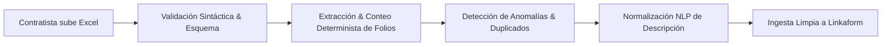

# Directiva y Reglas de Machine Learning & Calidad de Datos
## Proyecto: Sistema de Tickets para Folios con Errores HIT

### 1. Filosofía Data-Centric & Calidad de Datos
En este proyecto, asumimos un enfoque **Data-Centric AI**. Todo modelo predictivo o sistema automatizado de soporte depende de la calidad, consistencia y completitud con que se capturen los datos en origen.

---

### 2. Reglas de Validación y Preprocesamiento en Cliente (Edge Data Quality)

#### R-ML-01: Verificación de Esquema e Integridad de Archivos Excel
* **MIME types permitidos:** `.xlsx`, `.xls`.
* **Límite de tamaño:** Máximo 10 MB por archivo adjunto para prevenir desbordamiento de memoria y tiempos de carga excesivos en redes móviles de campo.
* **Inspección de estructura tabular:**
  - El archivo debe contener al menos una hoja de cálculo con filas no vacías.
  - Se debe validar la existencia de una columna identificadora de folios (ej. `Folio`, `Folio HIT`, `ID`).
  - Cada folio debe cumplir con el patrón de nomenclatura de folios HIT (ej. formato numérico o alfanumérico estandarizado).

#### R-ML-02: Conteo Determinista de Folios (`Numero de folios en excel`)
* El valor numérico del campo `6abc1b54d480ac87e62ccc17` **no debe depender de captura manual del usuario**.
* El parser de frontend leerá el binario (`SheetJS / xlsx`), contabilizará las filas válidas (excluyendo encabezados y filas vacías) y asignará el valor automáticamente.
* **Regla de consistencia:** Si el archivo contiene 0 folios o folios malformados, el sistema debe bloquear el envío y alertar al contratista.

#### R-ML-03: Detección Temprana de Anomalías (Outlier Detection)
* **Outliers por volumen:** Si un archivo contiene $> 500$ folios en un solo ticket, debe solicitar una confirmación explícita de volumen inusual antes del envío.
* **Folios duplicados intra-archivo:** Detectar si el mismo folio se repite dentro del mismo Excel y presentar advertencia de duplicidad al contratista.

---

### 3. Procesamiento de Lenguaje Natural (NLP) para Descripciones

#### R-ML-04: Sanitización y Normalización de Texto (`Descripcion`)
El campo de texto libre (`6ace7405cb9c71e698addfc1`) es la fuente principal para futuros modelos de clasificación automática de fallas:
* **Limpieza:** Eliminación de caracteres de control invisibles, truncamiento de espacios múltiples consecutivos y normalización Unicode NFC.
* **Extracción de Entidades (NER ligero en cliente):**
  - Detección de folios mencionados explícitamente en el texto para correlacionar con los folios del Excel.
  - Detección de palabras clave operativas (ej. `rechazado`, `no sube`, `sin foto`, `error de sistema`, `timeout`).

#### R-ML-05: Preparación de Datos para Modelos Supervisados de Triage
* Cada ticket creado debe preservar la tupla: `(Descripcion, Numero_Folios, Nombre_Contratista, Timestamp, Estatus_Final)`.
* Esto permitirá entrenar clasificadores de:
  1. **Categoría de Falla:** Asignación automática de etiqueta de error.
  2. **Severidad y Prioridad:** Estimación de tiempo requerido de atención y criticidad del lote de folios.
  3. **Reincidencia:** Detección de patrones de error repetitivos por contratista o región operativa.

---

### 4. Gobernanza y Mantenimiento del Dataset
* **No contaminación:** No permitir el envío de pruebas con datos ficticios a la forma de producción sin la bandera de `test_flag`.
* **Privacidad y Datos Personales (PII):** Los teléfonos y correos electrónicos de los contratistas se utilizan estrictamente para notificaciones de seguimiento operativo de Linkaform y no deben exponerse públicamente.
