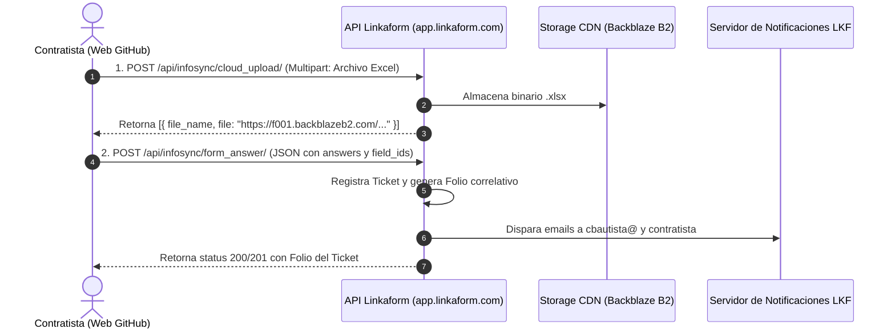

# Directiva y Reglas de Integración con Linkaform
## Proyecto: Conexión API y Sincronización de Tickets HIT

### 1. Especificación de Endpoints Oficiales de Linkaform

A través de la ingeniería inversa del cliente oficial de Linkaform para la forma `179149` (*Tickets Folios HIT*), se establecen los siguientes endpoints de operación:



| Operación | Método | Endpoint | Autenticación Requerida |
| :--- | :--- | :--- | :--- |
| **Consultar Estructura de Forma** | `GET` | `https://app.linkaform.com/api/infosync/get_form_for_answer/?form_id=179149` | Pública (`public: true`) |
| **Carga de Archivo Adjunto (Excel)**| `POST` | `https://app.linkaform.com/api/infosync/cloud_upload/` | Pública (contexto de forma pública) |
| **Creación de Registro (Ticket)** | `POST` | `https://app.linkaform.com/api/infosync/form_answer/` | Pública (contexto de forma pública) |
| **Gestión y Consulta Administrativa**| `GET/PATCH` | `https://app.linkaform.com/api/infosync/form_answer/` | API Key (`Authorization` / Sesión) |

---

### 2. Mapeo Canónico de Identificadores (`field_id`)

Para la forma **`179149` ("Tickets Folios HIT")**, todas las respuestas deben enviarse en el objeto `answers` usando los `field_id` oficiales:

```json
{
  "form_id": 179149,
  "geolocation": [],
  "answers": {
    "6ab1478e5fe35fa36de6cb1e": "SAID ARMANDO GONZALEZ PARMA",
    "6ab1478e5fe35fa36de6cb1f": "6462456583",
    "6ab599c75e02297c1d2a03df": "auxiliar.durangonortepci@gmail.com",
    "6ab1478e5fe35fa36de6cb21": [
      {
        "file_name": "reporte_errores_hit_octubre.xlsx",
        "file_url": "https://f001.backblazeb2.com/file/app-linkaform/public-client-1259/179149/..."
      }
    ],
    "6abc1b54d480ac87e62ccc17": 12,
    "6ace7405cb9c71e698addfc1": "Se presentaron folios rechazados por inconsistencia en carga HIT.",
    "6ab1478e5fe35fa36de6cb23": "en_progreso"
  }
}
```

---

### 3. Protocolo de Carga de Archivos (`cloud_upload`)

#### R-INT-01: Parámetros del Formulario Multipart
Al enviar el archivo a `https://app.linkaform.com/api/infosync/cloud_upload/`:
* **Campo de archivo:** `file` (el blob del archivo Excel).
* **Campos complementarios en el `FormData`:**
  - `field_id`: `"6ab1478e5fe35fa36de6cb21"`
  - `form_id`: `179149`
  - `properties`: `JSON.stringify({"mime_types":["xls","xlsx"],"max_images_count":5})`
* **Procesamiento de Respuesta:**
  La API retorna un arreglo de objetos JSON:
  ```json
  [
    {
      "file_name": "errores.xlsx",
      "file": "https://f001.backblazeb2.com/file/app-linkaform/public-client-1259/179149/6ab1478e5fe35fa36de6cb21/xxxx.xlsx"
    }
  ]
  ```
  Este resultado debe formatearse mapeando `file` a `file_url` para colocarlo en `answers["6ab1478e5fe35fa36de6cb21"]`.

---

### 4. Política de Seguridad y Credenciales

#### R-INT-02: Gestión de la API Key Privada vs Cliente Público
* **Credencial Administrativa:**
  - Usuario: `pahernandez@operacionpci.com.mx`
  - API Key: `003ab07a66c6795f8d3fcca2a3b6f94a7f06258e`
* **Directiva Crítica:**
  - Dado que la forma `179149` es **Pública** en Linkaform (`public: true`), el portal web para contratistas puede invocar los endpoints de captura (`cloud_upload` y `form_answer`) **directamente en modo público**, protegiendo la API Key administrativa de ser expuesta en el código fuente de GitHub Pages.
  - La API Key administrativa queda reservada para:
    1. Scripts de descarga masiva para entrenamiento de modelos de ML.
    2. Modificación de estatus (`PATCH` de "en_progreso" a "finalizado").
    3. Integraciones de backend y tableros analíticos internos.
