# Requerimientos Funcionales
## Sistema de Tickets y Turnos para Errores HIT (Operación PCI)

### 1. Actores y Entidades del Sistema

El sistema cuenta con **dos entidades principales** que interactúan directamente a través del portal web:

```mermaid
flowchart TD
    subgraph Contratistas
        A1["1. Ingresa Nombre, Teléfono, Correo"] --> A2["2. Adjunta archivo Excel (Encabezado + 1 folio por fila)"]
        A2 --> A3["3. Conteo automático de folios en navegador"]
        A3 --> A4["4. Clic en 'Subir Error y Obtener Turno'"]
        A4 --> A5["5. Registro en Linkaform (Estatus: En Progreso)"]
        A5 --> A6["6. Recibe Turno del Día (ej. Turno #04)"]
        A6 --> A7["7. Puede consultar en la web en qué turno va la responsable"]
    end

    subgraph Responsable ["Responsable (Mesa de Control HIT)"]
        B1["1. Ingresa a la pestaña 'Mesa de Control'"] --> B2["2. Visualiza cola de turnos y tickets del día"]
        B2 --> B3["3. Revisa o confirma número de folios (automático del Excel)"]
        B3 --> B4["4. Descarga Excel y atiende error en sistema HIT"]
        B4 --> B5["5. Agrega comentarios u observaciones (opcional)"]
        B5 --> B6["6. Marca ticket como 'Finalizado'"]
        B6 --> B7["7. Se actualiza Linkaform vía PATCH"]
        B7 --> B8["8. Linkaform envía automáticamente el correo de notificación al contratista"]
    end
```

---

### 2. Especificación por Entidad

#### Entidad A: Contratistas
* **Campos estrictos a capturar (Únicamente 4):**
  1. **Nombre Completo:** Requerido (mínimo 3 caracteres).
  2. **Teléfono de Contacto:** Requerido (10 dígitos numéricos).
  3. **Correo Electrónico:** Requerido (formato estándar RFC 5322).
  4. **Archivo Excel de Errores:** Requerido (formatos `.xlsx` o `.xls`).
* **Regla de folios:**
  - El Excel contiene una fila de encabezado y un folio por fila.
  - El contratista **no ingresa el número de folios manualmente**; el sistema lo calcula automáticamente en su navegador mediante SheetJS (`filas - 1`).
* **Sistema de Turnos del Día:**
  - Al enviar su ticket, se genera el registro en Linkaform con estatus inicial `en_progreso`.
  - El contratista recibe un **Turno del Día** correlativo (Turno #1, Turno #2, Turno #3...).
  - El navegador almacena su turno localmente para el día en curso.
  - Al ingresar a la web, el contratista visualiza un **Tablero en Vivo**:
    * **Turno en Atención Actual:** Muestra en qué turno va la responsable.
    * **Último Turno Emitido Hoy.**
    * **Tu Turno Actual:** Estado de su turno y cuántas personas restan antes de ser atendido.
  - **Restablecimiento Diario:** El conteo de turnos se reinicia automáticamente cada día a las 00:00 hrs.

---

#### Entidad B: Responsable de Atender Errores (Mesa de Control PCI)
* **Acceso:** Mediante la pestaña superior **"Mesa de Control"**.
* **Gestión de la Cola de Turnos:**
  - Visualiza los tickets del día ordenados por Turno cronológico.
  - Botón de control: *"Atender Siguiente"* para avanzar el indicador de turno en atención visible para los contratistas.
* **Número de Folios:**
  - Se muestra el conteo automático calculado desde el Excel al momento de la carga.
  - La responsable puede confirmar la cifra o ajustarla directamente en pantalla si fuera necesario.
* **Resolución de la Incidencia:**
  - Botón para descargar el archivo Excel original almacenado en Linkaform CDN (Backblaze B2).
  - Campo opcional de **Comentarios de Resolución**: para ingresar notas sobre la corrección en HIT.
  - Transición de Estatus: Cambio de `en_progreso` a `finalizado`.
* **Notificación Automática por Correo:**
  - Al hacer clic en *"Finalizar y Notificar por Correo"*, se envía un `PATCH` a Linkaform actualizando el estatus a `finalizado`.
  - La plataforma Linkaform dispara en automático el correo de confirmación al email del contratista.
